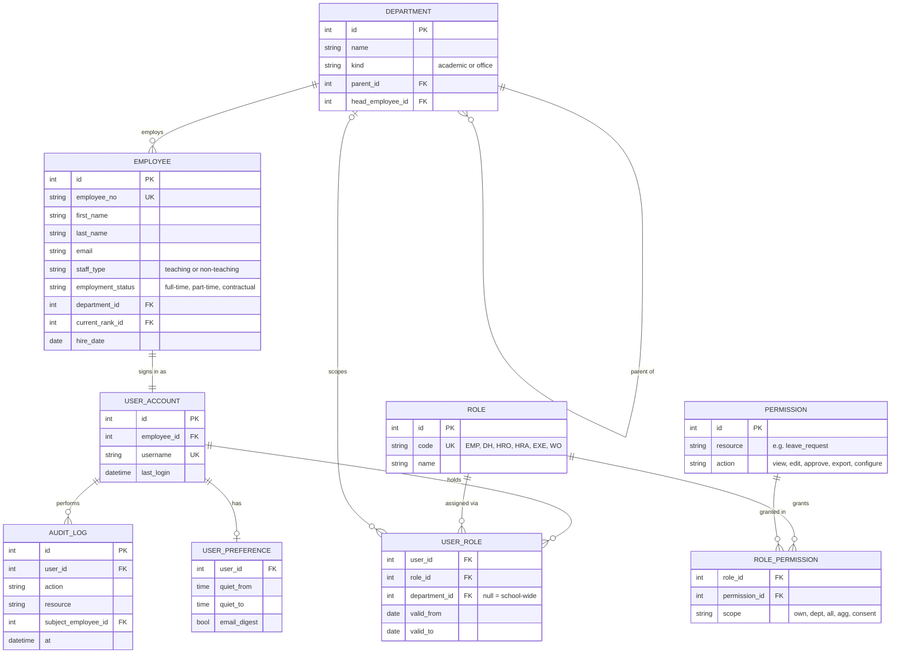
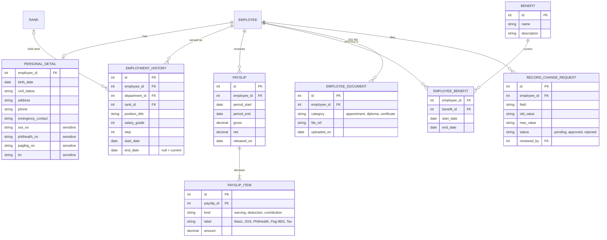
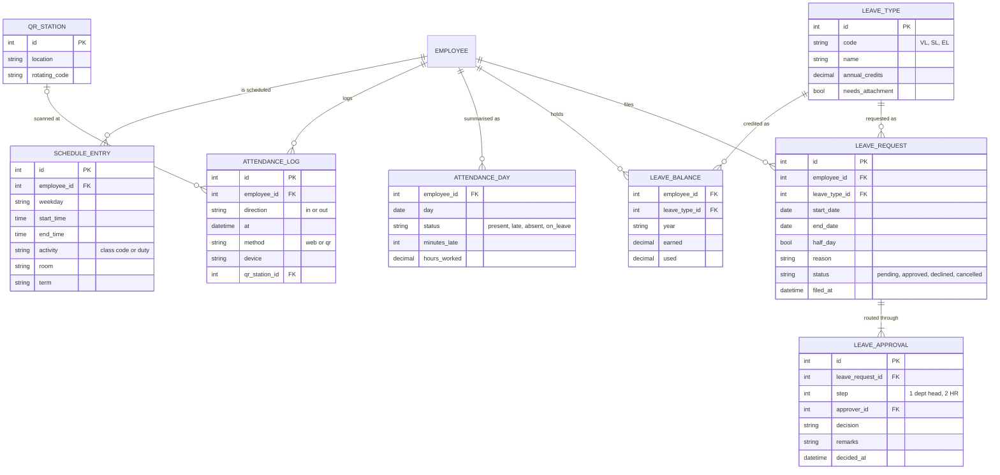
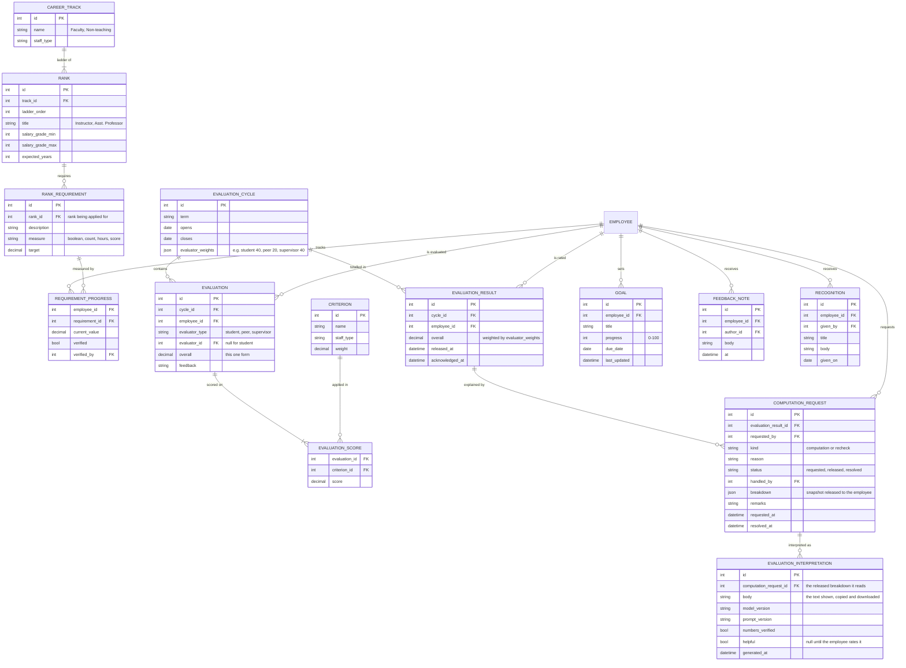
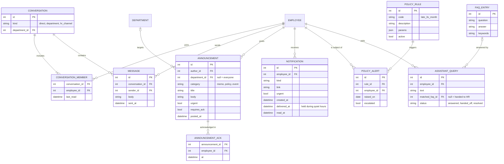
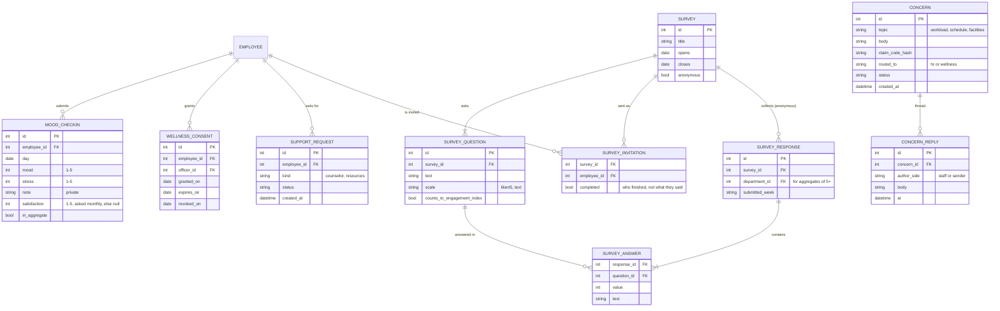
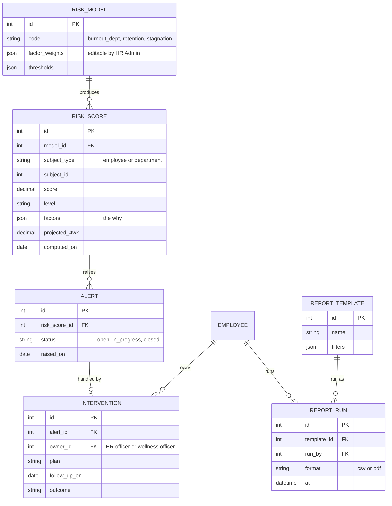

# Intelligent Faculty Management System: Prototype Plan

Planning document for the UI prototype and the theoretical database design. It does not replace the proposal. It takes what the proposal defines, compares it with what the prototype already shows, and lists what still has to be designed.

**Contents**

1. [Boundaries](#1-boundaries)
2. [How to read this plan](#2-how-to-read-this-plan)
3. [Module gap analysis](#3-module-gap-analysis)
4. [Cross-cutting requirements](#4-cross-cutting-requirements)
5. [Intelligence: rules and predictive scores](#5-intelligence-rules-and-predictive-scores)
6. [Analytics and charts](#6-analytics-and-charts)
7. [Role-based access control](#7-role-based-access-control)
8. [Theoretical ERD](#8-theoretical-erd)
9. [UI plan](#9-ui-plan)
10. [Usability test tasks](#10-usability-test-tasks)
11. [Build order](#11-build-order)
12. [Open decisions](#12-open-decisions)

---

## 1. Boundaries

**In scope.** The six modules defined under *Project Features* in the proposal:

1. Employee Profile & Records
2. Attendance & Schedule Management
3. Career Development & Performance
4. Employee Communication & Support
5. Emotional Wellness & Engagement
6. Admin Dashboard & Reporting

**Out of scope.** These come up in the Introduction (Frontline Education, 2024; Helios Ed, 2025; Multiable, 2024; PurelyHR, 2024) but are never defined as modules:

- Recruitment
- Onboarding
- Compliance tracking
- A training / professional development catalog

**Also excluded:**

- Payroll processing (the system only *displays* compensation records)
- Wearable stress monitoring (Williams & Langdon, 2021), which is cited as evidence only
- AI or ML models beyond rule-based scoring. The one exception is the AI interpretation of the evaluation breakdown (§5.5).

**Population.** Teaching and non-teaching personnel, as the respondents section names them: teachers, administrative staff, HR personnel and school administrators.

**Branding.** Generic school (`[School name]`), Philippine setting.

---

## 2. How to read this plan

Every feature row carries a **source** tag:

| Tag | Meaning |
|---|---|
| **R** | *Required.* Stated in the module's description under Project Features. |
| **T** | *Talked about.* Implied by the module's "Addresses" text, the Introduction, the RRL or the Methodology, but not specified as a feature. |
| **A** | *Added in planning.* Decided while planning this prototype; not in the proposal. |

…and a **prototype status** describing the current Django templates:

| Status | Meaning |
|---|---|
| **Built** | On screen with sample content (still static) |
| **Partial** | A placeholder, an inert button or a link to `#` exists |
| **Missing** | Nothing on screen yet |

---

## 3. Module gap analysis

### Module 1: Employee Profile & Records

*Problems addressed in the proposal: transparency issues, manual record-keeping.*

| Feature | Src | Prototype today | Plan |
|---|---|---|---|
| Personal details | R | Partial: link on Home | Profile screen with personal, contact and emergency-contact details. The employee views; HR edits. |
| Employment history | R | Partial: link on Home | Timeline of position, department, salary grade and step, with dates. |
| Compensation records | R | Partial: link on Home | Payslip list → payslip detail (earnings, deductions, net). View only. |
| Deductions & government contributions | R | Partial: link on Home | Contribution history (SSS/GSIS, PhilHealth, Pag-IBIG, withholding tax) with yearly totals. |
| Benefits | R | Partial: link on Home | List of the benefits an employee is enrolled in, with coverage dates. |
| Secure storage | R | Missing | Field-level RBAC: pay and government IDs visible to self and HR only. Sensitive views are audit-logged (§7). |
| Service record | T: DepEd (2020), Argana et al. (2020) | Missing | Printable service record generated from employment history. |
| Digital 201 file | T: Argana et al. (2020) digital archiving; "eliminates physical files" | Missing | Scanned documents (appointment papers, diplomas) attached to the record. Storage only, with no compliance tracking. |
| Record correction request | T: "accurate and updated information, improving trust" | Missing | The employee flags wrong data, HR reviews it, and the approved change is logged with old and new values. |

### Module 2: Attendance & Schedule Management

*Problems addressed in the proposal: delayed attendance reports, compliance stress.*

| Feature | Src | Prototype today | Plan |
|---|---|---|---|
| Time-in / time-out logging | R | Partial: inert buttons (Home, Dashboard) | Web button plus campus QR scan (**A**). Each log stores method, timestamp and device. |
| Leave requests | R | Partial: "Request leave" button, balances shown | Leave form with type, dates, half-day option, reason, attachment (sick leave) and a live balance check. |
| Leave approvals | R | Partial: pending table on Admin dashboard | Two steps: Department head, then HR officer (**A**). Remarks on each step; the employee is notified. |
| Absence / tardiness monitoring | R | Partial: counters on Home; recent attendance on Dashboard | Monthly daily time record (DTR) with a status per day and minutes late. Feeds policy alerts (M4) and analytics (M6). |
| Work hour summaries | R | Partial: "Hours this month" tile | Hours per week and month against expected hours; overtime shown separately. |
| Schedule management | R (module title) | Partial: "Today's schedule" on Dashboard | Weekly schedule: classes for teaching staff, duty shifts for non-teaching staff. The department head assigns it. |
| Leave history | T: "View history" button | Partial: inert button | List of past requests with status and approver remarks. |
| Real-time updates | T: "enabling real-time updates" | Partial: placeholder stat tiles | "Present now" and "On leave" counts. In the prototype, the counts are simulated. |

### Module 3: Career Development & Performance

*Problems addressed in the proposal: career stagnation, lack of feedback.*

| Feature | Src | Prototype today | Plan |
|---|---|---|---|
| Career Progress Tracker | R | Built (sample on `/dashboard/`, placeholder on `/`) | Keep the existing design. Add a second ladder for non-teaching staff (**A**). |
| Promotion eligibility | R | Built (sample requirement list) | Requirements per rank and per track, the share met, and an "Eligible" state. HR verifies completed items. |
| Salary grade progression | R | Missing (field exists only in the parked model) | Current salary grade and step, the date of the next step increment, and a salary-grade history chart. |
| Performance evaluations | R | Built (sample rating trend; student, peer and supervisor bars) | One result per cycle, combining the student, peer and supervisor evaluations. Result list → detail with criterion scores and written feedback. The employee **acknowledges** each result. |
| Evaluation computation request | A; supports T: Susanto et al. (2023) "transparent performance evaluation", Dizon (2022) | Missing | **Lives discreetly in the nav bar:** an **Evaluation breakdown** item under the Career menu, with no card or prompt on the dashboard. If HR has not released the breakdown yet, the employee **requests the computation** from that page. The HR officer releases a breakdown: each evaluator group's average and weight, the criterion scores, respondent counts, and the formula that gives the overall rating (small groups follow §7.3, rule 9). Individual student and peer answers stay anonymous. If the employee disagrees, they file a **recheck**, which HR resolves with remarks. |
| AI interpretation of the breakdown | A; supports T: Sadeghi (2024) personalised evaluations, Papaevaggelou et al. (2023) actionable feedback | Missing | On the Evaluation breakdown page, a plain-language reading of the released breakdown: strengths, areas to improve, and what it means for the next rank. The employee can **copy** it or **download** it as a PDF. Details and guardrails in §5.5. |
| Goal setting | R | Built (sample goals; "Add goal" inert) | Create and update goals with progress. The department head can comment. |
| Timely, actionable feedback | T: Papaevaggelou et al. (2023), Dizon (2022), Susanto et al. (2023) | Missing | Feedback notes between evaluation cycles. **Feedback overdue** flag when an employee has none in 6 months (§5.3). |
| Recognition | T: Dizon (2022), "feedback and recognition systems" | Missing | Commendations from the department head or HR, shown on the profile and in the employee's feed. |

### Module 4: Employee Communication & Support

*Problems addressed in the proposal: communication gaps, HR accessibility issues.*

| Feature | Src | Prototype today | Plan |
|---|---|---|---|
| Real-time internal chat | R | Missing ("Messages" links to `#`) | Messages screen with 1:1 threads, department group threads and an employee ↔ HR channel. |
| HR chatbot assistant | R | Built (static card on Home and Dashboard) | FAQ-matching assistant with suggested-question chips. **Hands the question off to HR** when no answer matches. HR Admin maintains the FAQs. |
| Automated alerts: policy violations | R | Missing | Rule-based (§5.4): tardiness over a threshold, absence without leave, missing time-out. Repeat violations notify the department head. |
| Automated alerts: updates | R | Partial: announcements list | Notification centre (bell) for leave decisions, released evaluations, new memos and approaching due dates. |
| Announcements and memos | T: Introduction, "paper memos"; "timely HR updates" | Built (static list) | HR composer with a department-level audience. Memos can require acknowledgment (read receipts). |
| Healthy boundaries | T: Bolli & Pusterla (2022), blurred work-life boundaries | Missing | Per-user **quiet hours**. Non-urgent notifications wait until working hours. |
| Mobile-friendly access | T: Blink, mobile-first frontline tools; Brasileño & Bidad (2021) infrastructure limits | Partial (breakpoints at 1260, 1200 and 900 px) | Check every screen at phone width. Keep pages light. |

### Module 5: Emotional Wellness & Engagement

*Problems addressed in the proposal: burnout and emotional fatigue, feeling undervalued.*

| Feature | Src | Prototype today | Plan |
|---|---|---|---|
| Daily mood check-in | R | Built (static, Wellness and Home) | One check-in per day, editable the same day. |
| Stress / burnout tracking | R | Built (stress slider, personal mood chart) | Personal mood and stress trend over 30 days, the semester or the school year. |
| Self-awareness prompts | T: Williams & Langdon (2021), self-awareness and self-care | Missing | Private insights for the employee, driven by the personal burnout score (§5.1), e.g. "Stress was high 4 of the last 7 days", with a resource link. |
| Engagement surveys | R | Partial (survey card placeholder) | Survey-taking screen and a survey builder for HR. Responses are anonymous; results are aggregate only. |
| Satisfaction over time | R: "track their satisfaction levels over time" | Missing | **Personal:** a one-question satisfaction rating added to the check-in once a month, private like the rest of the check-in. **Aggregate:** the engagement index per term, from the anonymous surveys. (Survey answers carry no employee link, so they cannot give a personal trend.) |
| Anonymous concerns | R: "express concerns anonymously" | Built (static form) | Routed by topic to HR or the wellness officer. A two-way anonymous thread through a claim code (**A**). |
| Retention support tools | R | Partial (support links) | Counselor request, resource library, and opt-in sharing with the wellness officer (**A**). |
| HR alerted to burnout trends | R | Built (static list on Admin dashboard) | Group-level burnout risk score (§5.1). Each alert opens an **intervention** (next row). |
| Timely intervention | T: Rony & Pardosi (2021) | Partial ("Plan an intervention" button) | Intervention record with owner, action plan, follow-up date and outcome. |
| Aggregate-only privacy | T: Sadeghi (2024) ethics + **A**: RA 10173 | Built (opt-in checkbox, privacy note) | Groups smaller than 5 are hidden. Individual data needs consent (§7.3). |

### Module 6: Admin Dashboard & Reporting

*Problems addressed in the proposal: lack of data for decision-making, manual workload.*

| Feature | Src | Prototype today | Plan |
|---|---|---|---|
| Attendance reports | R | Built (static chart, placeholder tiles) | Filter by department and period; table and chart; export. |
| Performance trends | R | Built (static line chart) | Department vs. school average, split by track. |
| Engagement data | R | Partial ("Quick reports" link) | Engagement index, survey response rates, concern topics. |
| Flagged wellness alerts | R | Built (static list) | Each alert shows *why* it was raised (§5) and the intervention status. |
| Real-time metrics | R | Partial (placeholder stat tiles) | Present today, on leave, pending approvals, open alerts. |
| Less repetitive reporting | R | Partial ("Export report" inert) | Saved report templates; one-click CSV/PDF export. |
| Career stagnation analytics | T: Introduction, the core problem statement | Missing | §6.3. |
| Retention analytics | T: Introduction, "retention challenges" | Missing | §6.2. |
| Role-specific dashboards | T: Tanucan et al. (2022), school-head leadership; **A** | Missing | Department head, Executive and Wellness officer views (§9). |

---

## 4. Cross-cutting requirements

These come from the RRL and Methodology rather than from any single module.

| Requirement | Source | What it means for the prototype |
|---|---|---|
| Explainable intelligence with human oversight | Sadeghi (2024) | Every score shows its contributing factors. The system only flags; a person decides. No automatic action is ever taken on an employee. |
| Ethical, transparent monitoring | Foreign Literature summary | Employees can see what data each score uses. Wellness data never feeds individual HR scores (§5.2). |
| Low digital skill and digital fatigue | Tusi-Leocario (2025); RAD section, "limited technical expertise and time" | Every common task (time-in, leave, check-in) takes at most 3 clicks. Plain labels and empty-state help text. |
| Infrastructure limits and staff resistance | Brasileño & Bidad (2021) | Light pages that work on phones; no heavy client app. |
| Employee self-service and autonomy | iSAMS (2023), PurelyHR (2024) | Employees answer their own "how many / where is / when" questions without asking HR. |
| Centralised, secure repository | PurelyHR (2024) | A single employee record that all modules reference (ERD §8). |
| Quality evaluation | Methodology, SUS; Argana et al. (2020), ISO 9126 | The prototype must support the SUS task list in §10. |
| Iterative, user-involved development | Methodology, RAD | The build order in §11 is a series of RAD iterations, each ending with a user review. |

---

## 5. Intelligence: rules and predictive scores

The "intelligent" part of the system is **rule-based scoring plus simple trend projection**. It needs no ML training data, every result can be explained, and every score is easy to defend before a panel. One feature uses a language model: the evaluation interpretation in §5.5, which explains a score but never produces one.

Every score and flag:

- uses weights or thresholds that HR Admin can configure (the values below are starting points to calibrate later);
- stores its factor breakdown, so the UI can show *why* it was raised;
- projects forward with a simple trend over the last 4–6 weeks, e.g. "at this rate, crosses High in about 3 weeks". This is the predictive element.

### 5.1 Burnout risk (department level)

| Factor | Weight | Data |
|---|---|---|
| Average stress, trend over 4 weeks | 30% | Mood check-ins (aggregate) |
| Average mood, trend over 4 weeks | 25% | Mood check-ins (aggregate) |
| Share of check-ins with stress ≥ 4 | 15% | Mood check-ins (aggregate) |
| Workload: hours above expected | 15% | Attendance |
| Unused leave late in the term | 10% | Leave balances |
| Drop in check-in participation | 5% | Mood check-ins |

- **Levels:** 0–49 Normal, 50–69 Watch, 70+ High.
- **Shown only** when the group has 5 or more contributing employees (§7.3).
- **Personal version:** the same factors for one person, visible **only to that employee**, and to the wellness officer if the employee consents.

### 5.2 Retention (attrition) risk (individual)

This score deliberately uses **no wellness data**, so the promise that check-ins stay private holds.

| Factor | Weight | Data |
|---|---|---|
| Years in current rank vs. the expected time | 30% | Employment history, career track |
| Performance evaluation trend falling | 20% | Evaluations |
| Absences or tardiness rising vs. the employee's own baseline | 20% | Attendance |
| Goals inactive for 60+ days | 15% | Goals |
| No feedback or recognition in 6+ months | 15% | Feedback, recognition |

- **Levels:** Low, Medium, High.
- **Visible to:** the department head (own department) and the HR officer. HR Admin sees aggregates only (§7.2).
- **Not visible to:** the employee. A "risk of leaving" label would hurt. Employees see the underlying items as **career health** on their tracker instead.
- **Executive view:** aggregate only.

### 5.3 Career stagnation and feedback flags (individual)

| Flag | Rule (default) |
|---|---|
| **Stagnant** | In current rank ≥ the expected years **and** requirements met < 60% |
| **Promotion-ready** | 100% of next-rank requirements met, not yet promoted |
| **Feedback overdue** | No evaluation or feedback note in 6 months |
| **Step increment due** | Salary step date within 60 days |

### 5.4 Policy alerts (Module 4)

| Rule (default, configurable) | Notifies |
|---|---|
| Late 3+ times in a calendar month | Employee; the department head on the 2nd month in a row |
| Absent with no leave filed | Employee and department head |
| Time-in with no time-out by end of day | Employee |
| Leave filed beyond the remaining balance | Employee (blocked at filing) |
| Leave pending for more than 3 working days | The approver at the current step |
| Evaluation computation request open for more than 5 working days | HR officer |

### 5.5 AI interpretation of the evaluation breakdown

A language model turns the released breakdown into a short, plain-language reading for the employee. This is the only feature in the system that uses one.

| Aspect | Plan |
|---|---|
| **Where** | The Evaluation breakdown page (Career ▾ → Evaluation breakdown), below the computation. It appears only once HR has released the breakdown. |
| **Input** | The released breakdown (group averages, weights, criterion scores, respondent counts), the previous cycle's overall rating, the next rank's evaluation requirement and the supervisor's written feedback. Names are removed from the feedback before it is sent. The model never receives the employee's name, employee number or any individual student or peer answers. |
| **Output** | Four short parts: (1) what the rating means, (2) strengths, the highest criteria, (3) areas to improve, the lowest criteria and the change since last cycle, (4) what it means for the next rank, with 1 to 3 suggested goals. |
| **Copy** | Copies the interpretation as plain text, disclaimer included. |
| **Download** | A PDF with the breakdown and the interpretation together, plus the date it was generated and the disclaimer. |
| **Who sees it** | The employee only. Department heads, HR and executives do not see the interpretation. |

**Guardrails** (Sadeghi, 2024):

- It is labelled *"AI-generated interpretation. Your official rating is the computation above."* on screen, in the copied text and in the PDF.
- It explains the rating but never changes a score, and HR decisions never use it.
- Every number it quotes must come from the breakdown. The server checks this before showing it and falls back to "Interpretation unavailable" if the check fails.
- The employee can regenerate it and mark it helpful or not helpful. Disputing the rating itself is still done through a recheck request (§3, Module 3).

**In the prototype:** fixed sample text. Copy works through the browser clipboard. Download uses the browser's print-to-PDF with a print layout.

---

## 6. Analytics and charts

All charts use Chart.js. The heatmaps use the `chartjs-chart-matrix` plugin. **Audience** says who sees the chart: Emp = employee, DH = department head, HR = HR officer and admin, Exec = executive, WO = wellness officer. "own" means the department head sees only their department.

### 6.1 Burnout and wellness

| Chart | Type | Audience | Notes |
|---|---|---|---|
| My mood and stress | Line, 2 series | Emp | Already drawn on Wellness as an SVG placeholder |
| Department mood and stress trend | Multi-line | HR, WO, DH (own), Exec | Aggregate, groups of 5+ |
| Stress heatmap: department × week | Matrix heatmap | HR, WO | Shows exam and grading weeks |
| Burnout risk by department | Horizontal bar with Watch and High bands | HR, WO, Exec | Clicking a bar opens the factor breakdown |
| Check-in participation | Line | HR, WO | A sudden drop is itself a signal |
| Concern topics | Bar | HR, WO, Exec | Counts only |

### 6.2 Retention

| Chart | Type | Audience |
|---|---|---|
| Turnover rate per term | Line | HR, Exec |
| Retention risk by department | Stacked bar (Low / Med / High) | HR, DH (own), Exec |
| Tenure distribution | Histogram | HR, Exec |
| Engagement index and response rate | Line + bar combo | HR, WO, DH (own), Exec |

### 6.3 Career stagnation

| Chart | Type | Audience |
|---|---|---|
| Years in current rank, by track | Histogram | HR, DH (own), Exec |
| Promotion readiness pipeline | Stacked bar (<50%, 50–99%, ready) | HR, DH (own), Exec |
| Feedback overdue | Stat tile + list | HR, DH (own) |
| Performance trend: department vs. school | Line, already drawn as an SVG placeholder | HR, DH, Exec |
| Rating breakdown (student / peer / supervisor) | Horizontal bars, already drawn on Dashboard; small groups follow §7.3, rule 9 | Emp, DH |
| Salary grade distribution | Bar | HR, Exec |
| My rating trend | Line, already drawn on Dashboard | Emp |

### 6.4 Attendance and leave

| Chart | Type | Audience |
|---|---|---|
| Attendance rate by week | Bar, already drawn as an SVG placeholder | HR, DH (own), Exec |
| Tardiness by weekday | Bar (Monday/Friday pattern) | HR, DH (own) |
| Leave utilisation by type | Stacked bar or doughnut | HR, DH (own) |
| Absence calendar | Calendar heatmap | HR, DH (own); Emp (own) |
| Approval aging | Bar (days pending) | HR, DH |
| My hours vs. expected | Progress bar | Emp |
| My leave balances | Doughnut per type | Emp |

---

## 7. Role-based access control

### 7.1 Why RBAC matters here

An HR system holds three kinds of data with very different sensitivity:

- **Administrative data:** attendance, leave.
- **Financial and identity data:** pay, government IDs.
- **Personal wellbeing data:** mood, stress, concerns.

A single "admin" account that sees everything would defeat the wellness module. Staff will not answer honestly if they believe their supervisor reads their check-ins (Sadeghi, 2024). RBAC makes three promises the system can keep:

1. **Least privilege.** Each role sees only what its job needs.
2. **Scope.** A department head's power stops at their own department.
3. **Separation of duties.** No one approves their own requests, and the people who configure the system do not automatically read sensitive data.

### 7.2 Roles

Every role is also an **Employee** for that person's own records, so a dean still files their own leave. A person can hold several roles, and their permissions are the union of them, each bound to its own scope.

| Role | Who | Default landing |
|---|---|---|
| **Employee** | Every teaching and non-teaching staff member | My dashboard |
| **Department Head** | Dean, principal, or office head of a unit | Department dashboard |
| **HR Officer** | Processes records, leave, evaluations, announcements | HR dashboard |
| **HR Admin** | Configures the system: roles, leave types, rules, career tracks, FAQs | Settings |
| **Executive** | President, VP, school director | Executive analytics (read-only) |
| **Wellness Officer** | Guidance counselor or wellness coordinator | Wellness dashboard |

HR Admin configures the system and sees aggregates, but does not read individual records. This keeps promise 3 above. Someone who must do both holds the HR Officer role as well, and every role grant is logged.

### 7.3 Data privacy rules

These rules apply in addition to the role matrix in §7.4.

1. **Minimum group size of 5.** Any aggregate of wellness or survey data from fewer than 5 people is hidden or merged into "Other".
2. **Individual check-ins** are visible to the employee alone. The only exception is the wellness officer, and only with **consent**: explicit, time-limited (default 90 days), revocable at any time, and logged.
3. **Survey responses** are stored without an employee link. Invitations track who has *completed* a survey but not *what* they answered.
4. **Anonymous concerns** store no sender identity. The sender can follow up only through a one-time claim code.
5. **Pay and government IDs** are visible to the employee and to HR officers only. Department heads, HR admins and wellness officers never see them.
6. **Executives** see aggregates and never drill down to individuals.
7. **Audit log.** Every view of another person's pay, government IDs, 201 file or consented wellness data is recorded.
8. **No self-approval.** A department head's own leave goes to their own superior or directly to HR. No one evaluates themselves as a supervisor.
9. **Evaluation breakdowns** show group averages, never individual answers.
    - The supervisor rating is shown as it is, since the evaluator is known.
    - If the student or peer group has fewer than 5 respondents, those two groups appear only as one combined figure, so the formula cannot be used to work out a small group's score.
    - Criterion scores are averaged across all evaluators.
10. **AI interpretations** are private to the employee. The model receives no name, employee number or individual answers (§5.5).

### 7.4 Permission matrix

The matrix is the same table split into three parts: records and attendance, career and communication, then wellness and administration.

**Scopes:** **Own** = own records · **Dept** = departments the user heads · **All** = whole school · **Agg** = aggregates only, groups of 5+ · **Consent** = individuals who consented · **—** = no access

**Actions:** V view · E create/edit · A approve · X export · C configure

#### Records and attendance

| Resource | Employee | Dept Head | HR Officer | HR Admin | Executive | Wellness Off. |
|---|---|---|---|---|---|---|
| Personal details, employment history | V Own | V Dept (basic) | V E All | — | Agg | V basic, Consent |
| Payslips, contributions, government IDs | V Own | — | V E All | — | Agg (totals) | — |
| 201 documents | V E Own | — | V E All | — | — | — |
| Record correction requests | E Own | — | A All | — | — | — |
| Attendance logs / DTR | E (time-in) V Own | V Dept | V E All | Agg | Agg | — |
| Schedules | V Own | E Dept | E All | — | — | — |
| Leave requests | E Own | A Dept (step 1) | A All (step 2) | Agg | Agg | — |
| Leave types and credit rules | V | V | V | C | V | — |

#### Career and communication

| Resource | Employee | Dept Head | HR Officer | HR Admin | Executive | Wellness Off. |
|---|---|---|---|---|---|---|
| Performance evaluations | V Own + acknowledge | E Dept (supervisor) | V All, run cycles | C criteria and weights | Agg | — |
| Evaluation computation requests | E Own (request, recheck) | V Dept | A All (release breakdown, resolve recheck) | — | — | — |
| AI interpretation of the breakdown | E Own (generate, copy, download) | — | — | — | — | — |
| Goals, feedback notes, recognition | E Own (goals) | E Dept | V E All | — | — | — |
| Career tracks and requirements | V | V | E (verify progress) | C | V | — |
| Salary grade progression | V Own | — | V E All | — | Agg | — |
| Retention risk / stagnation flags | Career health, Own | V Dept | V All | Agg | Agg | — |
| Messages | E own threads | E own threads | E own threads | E own threads | E own threads | E own threads |
| Announcements | V | E Dept audience | E All | E All | E All | E wellness topics |
| Policy alerts | V Own | V Dept | V All | C rules, Agg | Agg | — |
| HR assistant (FAQ) | Use | Use | E answers, handoffs | C | Use | Use |

#### Wellness and administration

| Resource | Employee | Dept Head | HR Officer | HR Admin | Executive | Wellness Off. |
|---|---|---|---|---|---|---|
| Mood check-ins (individual) | E V Own | — | — | — | — | V Consent |
| Wellness aggregates, burnout risk | — | Agg Dept | Agg All | Agg All | Agg | Agg All |
| Engagement surveys | Answer (anonymous) | Agg Dept | E surveys, Agg All | Agg All | Agg | Agg All |
| Anonymous concerns | Send; follow up by code | — | V reply (HR topics) | — | Agg (counts) | V reply (wellness topics) |
| Interventions | — | V Dept | E | Agg (counts) | V summary | E |
| Reports and export | — | X Dept | X All | X Agg | X Agg | X Agg |
| Roles, permissions, rules, risk weights | — | — | — | C | — | — |
| Audit log | — | — | — | V | — | — |

> Messages are private to their participants. Even HR Admin cannot read other people's threads.

---

## 8. Theoretical ERD

### Starting point

The parked `hr/models.py` was used as the starting point. It is not modified yet.

**Kept, with changes:**

- `Department`
- `Employee`
- `AttendanceRecord` → split into raw logs and a daily summary
- `LeaveRequest`
- `PerformanceEvaluation`
- `Goal`
- `CareerMilestone` → replaced by track, rank and requirement
- `Announcement`
- `ChatMessage` → conversations
- `ChatbotFAQ`
- `MoodCheckIn`
- `EngagementSurvey`
- `WellnessAlert` → generalised into risk scores, alerts and interventions

**Main changes:**

| Change | Reason |
|---|---|
| `Employee.role` (single choice) → `USER_ROLE` with a department scope | Supports multi-role users and department-scoped heads (§7) |
| Fixed SSS/PhilHealth/Pag-IBIG columns → `PAYSLIP_ITEM` rows | Any deduction or benefit can be added without schema changes |
| `CareerMilestone` per employee → shared `CAREER_TRACK` / `RANK` / `RANK_REQUIREMENT` plus per-employee progress | Requirements are defined once, and teaching and non-teaching staff get separate ladders |
| `EngagementSurvey` with response counts → survey, questions, invitations and anonymous responses | Keeps survey answers anonymous (§7.3, rule 3) |
| Added `WELLNESS_CONSENT`, `CONCERN`, `INTERVENTION`, `RISK_SCORE`, `POLICY_RULE`, `AUDIT_LOG` | Needed for consent, intervention workflow, explainable scores and accountability |
| `PerformanceEvaluation` → `EVALUATION` (one evaluator's form) plus `EVALUATION_RESULT` (the weighted rating per cycle) | The overall rating the employee sees combines several forms, so it needs its own record |
| Added `COMPUTATION_REQUEST`, plus evaluator-group weights on `EVALUATION_CYCLE` | Lets an employee request and receive the breakdown of their rating |
| Added `EVALUATION_INTERPRETATION` | Stores each AI interpretation with the model and prompt version that produced it |

### 8.1 Identity, organisation and RBAC

### 8.2 Module 1: Profile and records

### 8.3 Module 2: Attendance and schedule

### 8.4 Module 3: Career and performance

### 8.5 Module 4: Communication and support

### 8.6 Module 5: Wellness and engagement

Note what is **missing on purpose**: `SURVEY_RESPONSE` and `CONCERN` have no link to `EMPLOYEE`.

### 8.7 Module 6: Analytics, alerts and interventions

---

## 9. UI plan

### 9.1 Approach

- **Role switcher.** A "View as" control in the header (Employee, Department Head, HR Officer, HR Admin, Executive, Wellness Officer). Switching changes the nav and the landing page. There is no login in the prototype.
- **Static data.** Sample data lives in a Python module and is passed to templates as context. Pages still make **zero database queries**, so the existing test stays valid.
- **Charts.** Chart.js loaded from a CDN with a pinned version, plus `chartjs-chart-matrix` for the heatmaps. Colours come from the existing tokens (`--maroon`, `--gold`).
- **Branding.** Generic school. `/dashboard/` sample data loses "University of Batangas", "Prof. Maria L. Reyes" and "CICT", and the test marker is updated to match.

### 9.2 Screens

**Tier 1** is needed for the pitch and the SUS tasks. **Tier 2** is nice to show.

| Role | Screen | Status | Tier |
|---|---|---|---|
| **Employee** | My dashboard (`/dashboard/` design, made generic) | Update | 1 |
| | Evaluation breakdown (nav: Career ▾ → Evaluation breakdown): rating computation, or the request button if not released, plus recheck; AI interpretation panel with Copy and Download PDF | New | 1 |
| | My records: profile, employment history, payslips, contributions, benefits, 201 file, correction request | New | 1 |
| | Attendance: time-in (web + QR), DTR calendar, schedule, file leave, leave history | New | 1 |
| | Career: tracker, requirements, salary grade path, evaluations + acknowledge (each links to its breakdown), goals, recognition | New | 1 |
| | Messages + notification centre + announcements | New | 2 |
| | Wellness (existing) + insights + consent sharing + concern follow-up | Update | 1 |
| | HR assistant (full page, with handoff to HR) | New | 2 |
| **Department Head** | Department dashboard: present today, approvals, evaluation status, feedback overdue, retention watchlist, department wellness aggregate | New | 1 |
| | Leave approvals (step 1) | New | 1 |
| | Team: roster, supervisor evaluations, feedback notes, recognition | New | 2 |
| **HR Officer** | HR dashboard (existing Admin dashboard, rebuilt with real charts, department and period filters, and Export) | Update | 1 |
| | Employee directory → record view and edit | New | 2 |
| | Evaluation computation requests: queue, release breakdown, resolve recheck | New | 1 |
| | Leave processing (step 2) | New | 2 |
| | Alerts and interventions | New | 1 |
| | Announcements composer, concern inbox, saved report templates | New | 2 |
| **HR Admin** | Settings: roles and permissions matrix, leave types, policy rules, career tracks, risk weights, FAQ editor, audit log | New | 2 (roles + risk weights: 1) |
| **Executive** | Executive analytics: headcount, turnover, attendance, performance, engagement index, burnout map, promotion pipeline | New | 1 |
| **Wellness Officer** | Wellness dashboard: aggregates, heatmap, consented cases, counselor requests, concern inbox, interventions | New | 1 |

### 9.3 Existing screens

| Screen | Decision |
|---|---|
| `/` (bracketed placeholder Home) | Retire in favour of `/dashboard/` (see §12) |
| `/dashboard/` | Becomes the Employee landing page; make generic; swap SVG charts for Chart.js |
| Header nav (`base.html`) | "Career" becomes a small dropdown: Progress, Evaluations, Evaluation breakdown. The gold "Admin dashboard" button is replaced by the "View as" role switcher. |
| `/wellness/` | Keep; add insights, consent and concern follow-up |
| `/admin-dashboard/` | Becomes the HR dashboard; fill the placeholders; add burnout, retention and stagnation panels |

---

## 10. Usability test tasks

These support the proposal's System Usability Scale evaluation. Each task should be completable in the prototype.

| # | Role | Task |
|---|---|---|
| 1 | Employee | Time in using the QR option |
| 2 | Employee | File a 2-day vacation leave and check that the balance updates |
| 3 | Employee | Find the government contribution deducted on the latest payslip |
| 4 | Employee | Find which requirement is still missing for the next rank |
| 5 | Employee | Submit today's check-in and view the 30-day trend |
| 6 | Employee | Send an anonymous concern about workload |
| 7 | Employee | Ask the HR assistant how to file sick leave |
| 8 | Employee | From the nav bar, open the computation behind the latest evaluation rating, requesting it if it has not been released |
| 9 | Employee | Copy the AI interpretation of that breakdown, then download it as a PDF |
| 10 | Department Head | Approve a pending leave request with a remark |
| 11 | Department Head | Identify which team member's feedback is overdue |
| 12 | HR Officer | Open the highest burnout alert, read why it was raised, and start an intervention |
| 13 | HR Officer | Release the breakdown for a pending evaluation computation request |
| 14 | HR Officer | Export this month's attendance report for one department |
| 15 | Executive | Find which department has the most staff who are promotion-ready |

---

## 11. Build order

Each iteration ends with a review by the team (and ideally a few end users), following the proposal's RAD methodology.

| Iteration | Contents |
|---|---|
| **0: Plan** | This document, reviewed and adjusted |
| **1: Shell** | Role switcher, per-role navigation, Chart.js setup, sample-data module, generic branding, updated tests |
| **2: Employee** | Dashboard, My records, Attendance & leave, Career, Evaluation breakdown with AI interpretation, Wellness updates (Tier 1) |
| **3: Oversight** | Department dashboard and approvals, HR dashboard rebuild, computation-request queue, alerts and interventions |
| **4: Analytics** | Executive analytics, Wellness officer dashboard, HR Admin roles and risk-weight screens |
| **5: Polish** | Tier 2 screens as time allows; walk through every §10 task; check phone widths |

---

## 12. Open decisions

| # | Question | Recommendation |
|---|---|---|
| 1 | Retire the bracketed `/` Home and keep only the `/dashboard/` design? | Yes. Two Employee homes will confuse demo viewers. |
| 2 | Which rank ladder for the demo? The proposal's RRL leans toward basic education (Teacher I–III, Master Teacher), while the current dashboard uses college ranks (Instructor → Professor). | Make tracks configurable. Demo with one teaching ladder and one non-teaching ladder (e.g. Staff I → III → Supervisor). |
| 3 | Leave approval chain: department head, then HR (2 steps)? | Yes, with the department head's own leave going straight to HR. |
| 4 | Minimum group size for aggregates | 5 |
| 5 | Consent duration for wellness-officer access | 90 days, revocable |
| 6 | Shareable version of this plan for the pitch | A one-page approval summary exists as a shared doc. Produce a full shareable version only after this plan is approved. |
| 7 | Which language model powers the evaluation interpretation, and is it acceptable for evaluation data to leave the school's servers? | Decide before a real build. The prototype uses fixed sample text, so nothing is sent anywhere. |
